<p align="center"></p>

<p align="center"><strong>The smart clinic platform for healthcare teams: less admin, more time for patients.</strong></p>

<p align="center">
  
  
  
  
</p>

<p align="center"><a href="https://aivin.myavantec.com">Platform page</a> · <a href="https://aivin.myavantec.com/demo/">Demo clinic</a></p>

Hy+ Clinic turns manual clinic work into one connected digital flow: online booking and queue numbers, a self check-in kiosk (AIVIN, AI-Vital Intake) that reads health-check devices over Bluetooth, the doctor's workspace with an AI pre-consultation summary, a waiting-room TV, a patient portal and live operations analytics. It runs under the clinic's own brand, with one isolated installation and database per clinic.

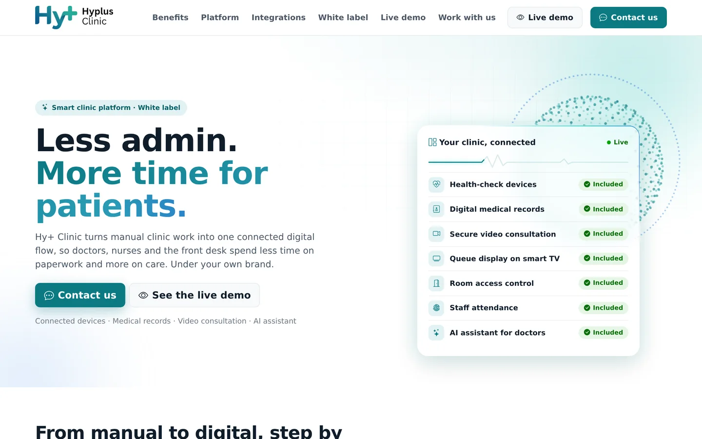

## Screenshots

All screenshots show real screens with fictional demo data.

| Today: what the desk acts on now | Analytics: how the clinic is doing |
|---|---|
| 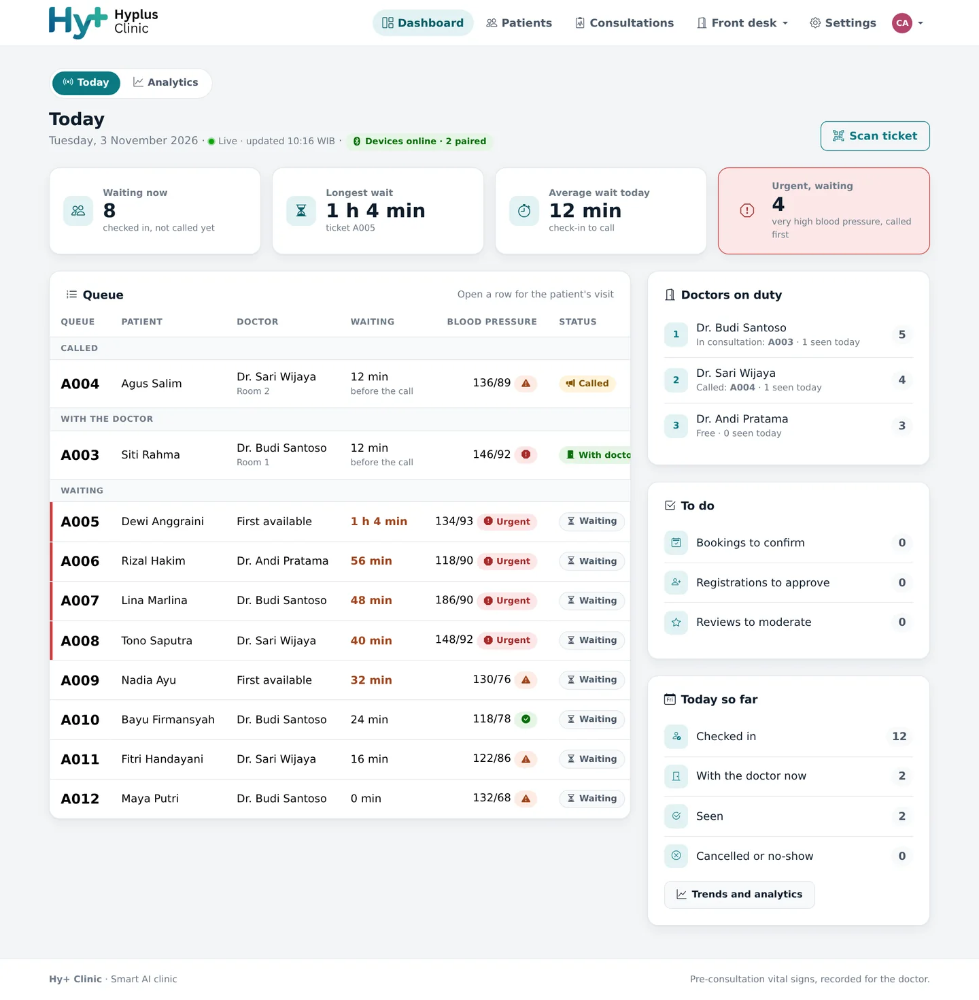 | 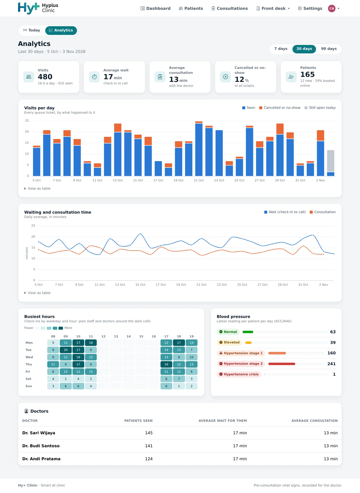 |

| Doctor's workspace and AI summary | Doctor's queue |
|---|---|
| 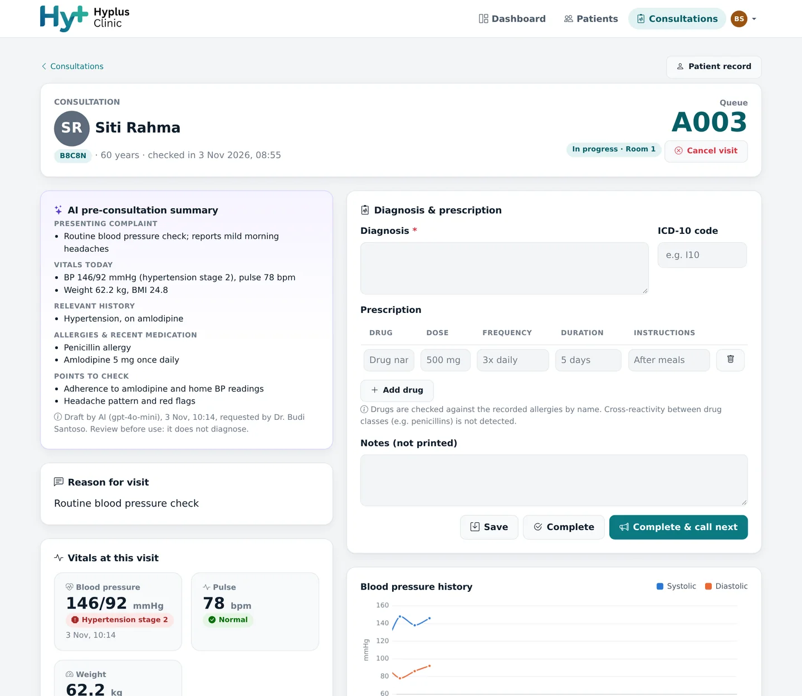 | 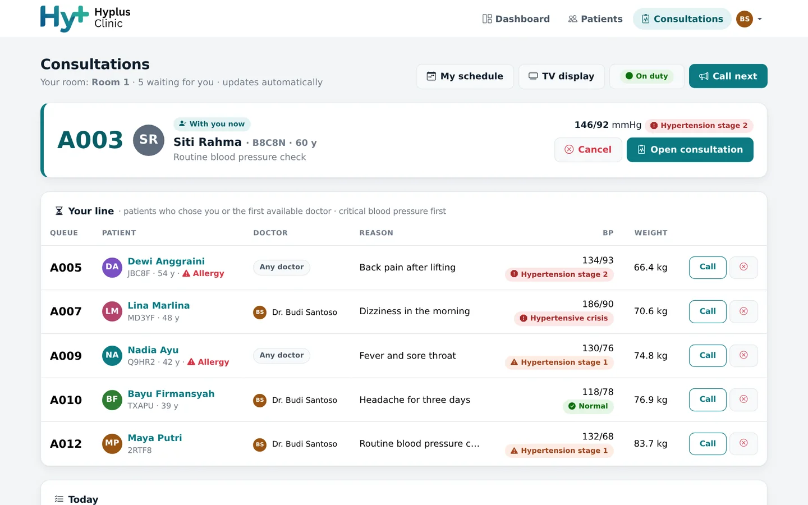 |

| Self check-in kiosk | Reading from the device | Ticket |
|---|---|---|
| 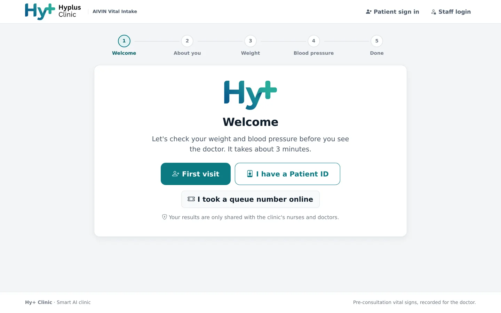 | 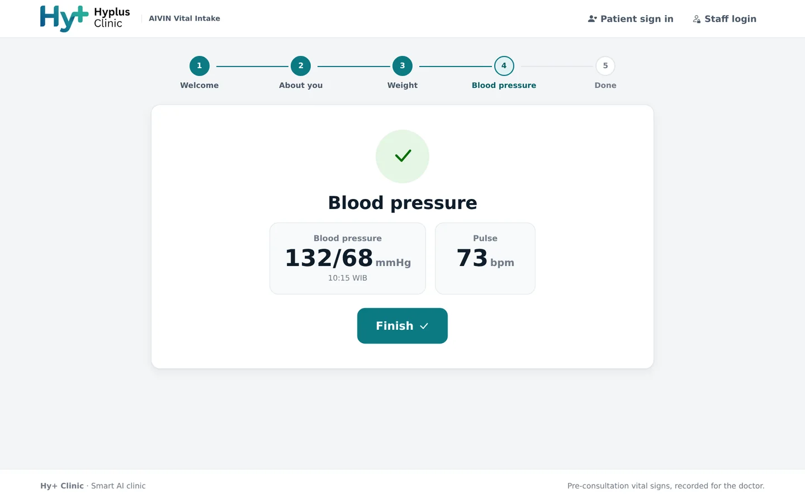 | 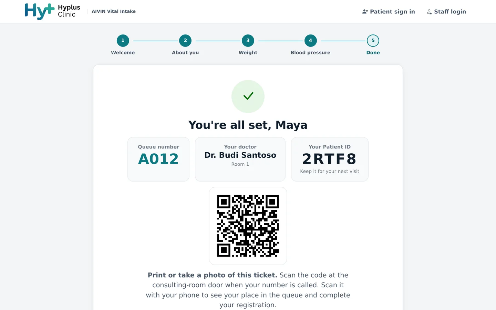 |

| Waiting-room TV | Settings: every module as a card |
|---|---|
| 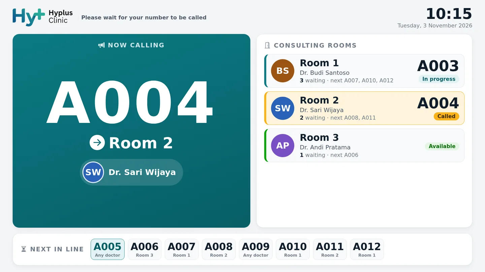 | 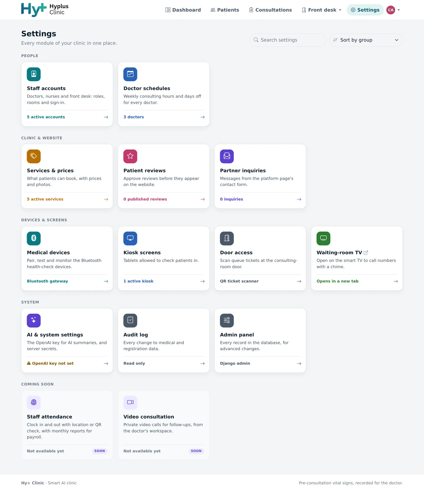 |

| Smart booking | Live place in the queue | Patient portal |
|---|---|---|
| 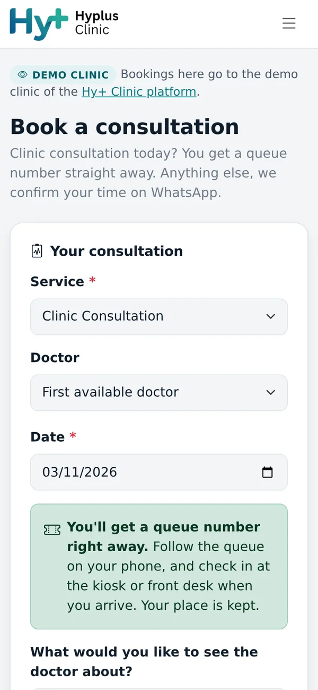 | 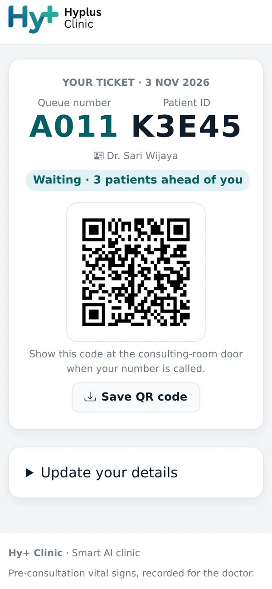 | 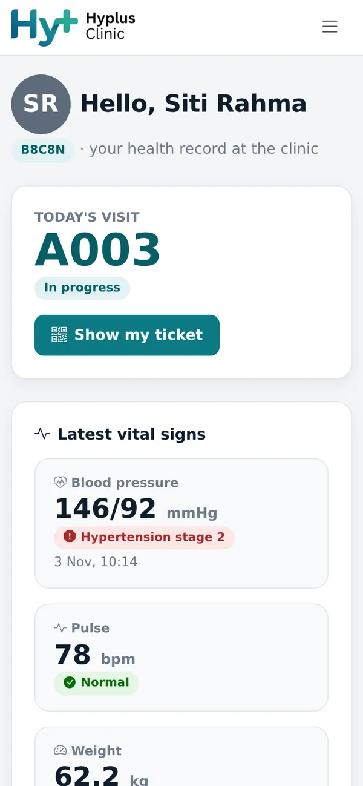 |

## Features

**Patients**
- Online booking and same-day queue numbers, with a choice of doctor
- QR ticket with their live place in the queue
- Patient portal: visits, diagnoses, vital-sign trends and printable prescriptions

**Kiosk and devices**
- Voice-guided self check-in for new and returning patients and online tickets
- Bluetooth readings sent straight to the record through a gateway on the clinic's server (OMRON HEM-6232T blood pressure monitor and HN-300T2 scale in this repository)
- Readings checked against clinical guidelines; patients with very high blood pressure are called first

**Doctors and staff**
- Digital medical records: history, allergies, vital-sign trends, ICD-10 diagnoses and prescriptions checked against recorded drug allergies
- AI pre-consultation summary from de-identified data, always reviewed by the doctor
- One-tap calling, weekly doctor schedules, and a waiting-room TV with a chime
- Ticket scanning at the consulting-room door

**Clinic management**
- **Today** dashboard: the live queue, longest and average wait, urgent patients, doctors on duty and the front desk's to-do list
- **Analytics** (7, 30 or 90 days): visits by outcome, waiting and consultation time, busiest hours, blood pressure categories and per-doctor figures
- **Settings** home: every module as a card, with search and sorting, filtered by role

**Coming soon in this repository:** staff attendance and video consultation.

## Architecture

| Component | Technology |
|---|---|
| App | Django 5.2 served by Gunicorn, static files by WhiteNoise |
| Database | PostgreSQL 16 |
| Runtime | Docker Compose (`aivin` project), app port bound to `127.0.0.1` only |
| Devices | BLE gateway on the server's Bluetooth adapter (BlueZ) |
| Public access | Cloudflare Tunnel (`cloudflared`) terminates HTTPS |
| Android | Capacitor wrapper that loads the hosted app |

```
Browser / tablet ──HTTPS──> Cloudflare ──tunnel──> cloudflared (host) ──> 127.0.0.1:8010 ──> web (Gunicorn) ──> db (PostgreSQL)
```

Who can see what:

- **Public:** the platform page (`/`), the demo clinic website (`/demo/`), booking, and the waiting-room TV (`/display/`, queue numbers and rooms only).
- **Registered kiosks:** the check-in kiosk (`/kiosk/`) and its API, on browsers set up under Settings › Kiosk screens, or for signed-in staff.
- **Staff login, by role:** dashboard, patients, consultations, front desk tools and settings.
- **Administrators only:** Analytics, staff accounts, and Admin → System settings.

## Security

Role-based access checked on the server, a strict Content Security Policy with per-request nonces, an audit trail of medical and registration changes, encrypted secrets, rate limiting on public forms, and only the last 4 characters of ID documents stored. See [Secrets and configuration](#secrets-and-configuration).

## Deploying on Debian

Requirements: Docker Engine with the Compose plugin, `make`, `python3`, and a running Cloudflare Tunnel.

```bash
cd monolith
make init-env          # creates .env with generated SECRET_KEY, FIELD_ENCRYPTION_KEY and DB password
make up                # builds the image, starts db + web, runs migrations
make createsuperuser   # first administrator account (interactive)
```

Then, in the Cloudflare Zero Trust dashboard, add a public hostname to the tunnel (for example `clinic.example.com`) pointing to `http://localhost:8010`. The hostname must be listed in `ALLOWED_HOSTS` and `CSRF_TRUSTED_ORIGINS` in `.env`. Run `make restart` after editing `.env`.

Check that the app is up: `curl http://127.0.0.1:8010/healthz/` should return `{"status": "ok"}`.

## Patients, registration and doctors

- **Patient ID**: every patient gets a 5-character ID (e.g. `K7M2Q`), shown on the kiosk ticket. Returning patients choose *I have a Patient ID* at the kiosk.
- **Ticket QR code** links to `PUBLIC_BASE_URL/v/<token>/`. Staff who scan it while signed in open the visit. A patient who scans it with their phone gets a form to complete their registration. The form never shows stored data, expires after 7 days, and its answers wait in **Registrations** until staff approve them.
- **Staff accounts** are managed by administrators under **Staff** (or *Add staff member* on Registrations). Roles:
  - *Doctor*: records diagnoses and prescriptions.
  - *Nurse*: also manages the OMRON devices and merges duplicate records.
  - *Front desk*: registers patients and reviews registrations.
  - *Administrator*: everything, including staff accounts.

  Each role only sees the menus it can use, and the server refuses the rest (doctors, for example, have no Kiosk, Registrations or Scan ticket pages).

  Administrators never set passwords: a new account (or a reset) gives a one-time setup link, valid 3 days, to send to the staff member. Accounts are deactivated, not deleted, so records keep their author.
- Prescriptions are checked by name against the patient's recorded drug allergies; cross-reactivity between drug classes is not detected.
- Only the last 4 characters of an ID document are stored. Changes to registration and medical data are recorded in an audit log shown on each patient's page.

## Queue, TV display and access control

1. The kiosk prints (or shows) the ticket: queue number, Patient ID and QR code. Patients who scan it on their phone see their place in the queue, can save the QR code and complete their registration.
2. The waiting-room TV opens `/display/` (no login; it shows queue numbers and rooms only). Tap once to enable the chime. It lists every doctor on duty with their photo (or initials) and room (In progress, Called or Available), and the next 10 numbers in line; doctors switch **On duty / Off duty** on the Consultations page. Only on-duty doctors' photos are served to the TV; patient photos never are.
3. A doctor presses **Call next** (or **Call** on a patient) under Consultations. The TV plays a chime and shows the number and the doctor's room. Each doctor's room is set under **Staff**.
4. At the consulting-room door, staff scan the ticket under **Scan ticket** (access control). It turns green only for called patients, and the visit becomes **In progress** on the TV and on the doctor's screen.
5. The doctor records the diagnosis and prescription and presses **Complete & call next**; the TV moves on to the next number. Critical blood pressure is called first.
6. Doctors, nurses and administrators can **cancel** a queued visit (no-show, patient left, duplicate…). A reason is required. The visit leaves the queue and the TV but is never deleted: its record, vitals, the reason and who cancelled it are kept.

## Patient portal

Patients can have their own account to see their visits, vital signs (with charts), diagnoses and prescriptions; doctors' internal notes are never shown.

- Approving a registration (or **Portal access → Send account link** on a patient's page) creates a one-time link, valid 3 days, with a button to send it on WhatsApp to the patient's phone, exactly like staff invitations.
- To activate, the patient confirms their date of birth, agrees to the privacy notice and chooses a password. They sign in at `/portal/login/` with their Patient ID.
- Front desk, nurses and administrators can send a new link (password reset) or disable access. Patient accounts never appear in, and cannot be turned into, staff accounts; every staff page refuses them.
- Health data is "specific personal data" under Indonesia's UU PDP (No. 27/2022): have the clinic review the privacy notice text in `kiosk/templates/kiosk/portal_setup.html`.

## Profile photos

Staff upload their photo under **My profile** (their name, top right); patients upload theirs in the portal. Without a photo, the person's initials are shown on a colour that stays the same for them. Uploads (JPG/PNG/WebP up to 5 MB) are rotated upright, cropped square to 256×256 and re-saved without metadata, so location data in phone photos is removed. Photos are never public: patient photos are visible to clinic staff and the patient only, staff photos to signed-in users; the TV shows only the photos of doctors on duty.

## Medical devices (OMRON)

Supported: **HEM-6232T** wrist blood-pressure monitor and **HN-300T2** scale. They are read by the BLE gateway (`monolith/gateway`) on the server's own Bluetooth adapter, so **the devices must be within Bluetooth range of the server** (same room, roughly 5–10 m). Tablets and phones only need a browser.

The protocol implementation is vendored from [eigger/hass-omron](https://github.com/eigger/hass-omron) (MIT). Its HN-300T2 support is marked beta upstream.

Pair each device once, from **Settings › Medical devices** (staff login):

1. Remove the device from the OMRON connect app / phone Bluetooth settings first. A device talks to one host at a time.
2. Hold the device's Bluetooth button until `-P-` blinks, click **Scan**, choose the model and click **Pair**. The device shows `OK` when it worked.
3. Use **Test connection** (press the device's Bluetooth button first to wake it). It reads the latest stored measurement without saving it to any patient.

The same is available from the terminal: `make devices-scan`, `make devices-pair ADDRESS=... MODEL=HEM-6232T`, `make devices-list`.

During a check-in, the kiosk's weight and blood-pressure steps wait for the device and show the result automatically. Readings are only accepted if the device timestamp is after the step started; the gateway keeps the device clocks in sync. Check the gateway with `make gateway-logs`.

Simulated measurements (random values) are only available with `DEBUG=true`, and are stored with source "simulated".

## Secrets and configuration

| Secret | Where it lives | How to change it |
|---|---|---|
| OpenAI API key | Database, Fernet-encrypted | **Admin → System settings**. The field is write-only: the stored key is never shown again, only a hint like `sk-…abcd`. |
| `SECRET_KEY` | `monolith/.env` (mode 600) | Generated by `make init-env`. Edit `.env` and run `make restart`. This signs everyone out. |
| `FIELD_ENCRYPTION_KEY` | `monolith/.env` | Generated by `make init-env`. **Back it up.** If it is lost or changed, stored secrets cannot be decrypted and must be entered again. |
| Database password | `monolith/.env` | Generated by `make init-env`. |

`SECRET_KEY` and `FIELD_ENCRYPTION_KEY` deliberately cannot be edited from the web UI. Django needs them before it can read the database, and changing them from a web form would let one compromised admin session lock out or sign out everyone.

Application code reads the OpenAI key with `kiosk.models.get_openai_api_key()`.

All other settings are documented in [`monolith/.env.example`](monolith/.env.example).

## Operations

Run these commands from `monolith/`:

| Command | What it does |
|---|---|
| `./start.sh` | Start, rebuild, stop or restart the app, and show its status and logs |
| `make ps` / `make logs` | Container status and app logs |
| `make up` | Rebuild and redeploy after pulling new code (migrations run automatically) |
| `make backup` | Write a gzipped `pg_dump` and an archive of profile photos to `monolith/backups/` (git-ignored) |
| `make restore FILE=backups/<file>.sql.gz` | Restore a dump |
| `make restore-media FILE=backups/aivin-media-<stamp>.tar.gz` | Restore profile photos |
| `make down` | Stop the stack. Data is kept in the `aivin_pgdata` volume. |

Schedule `make backup` (for example a daily cron job), and copy the backups and `.env` off the server.

## Development

```bash
make test        # run the test suite inside the container, against PostgreSQL
```

To run without Docker, create a virtualenv, install `monolith/requirements.txt`, set `DEBUG=true` in `.env`, and leave out the `POSTGRES_*` variables so SQLite is used. Then run `python manage.py migrate` and `python manage.py runserver`.

## More documentation

- [docs/device-testing.md](docs/device-testing.md): testing with real Omron Bluetooth devices
- [docs/legacy/](docs/legacy/): notes from the earlier Windows-based setup. They are kept for reference and are not maintained.
